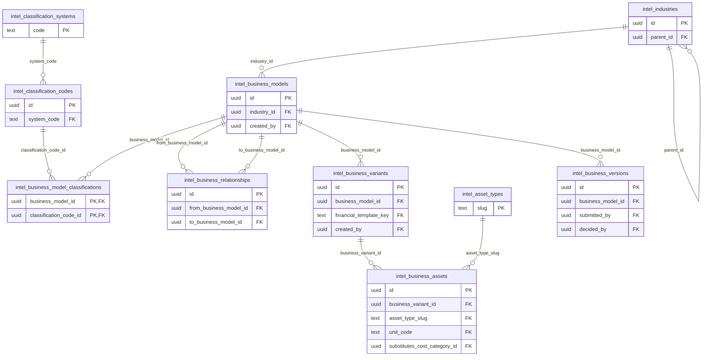
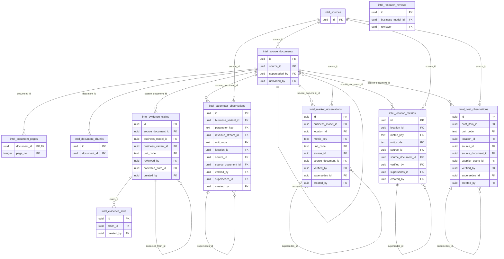
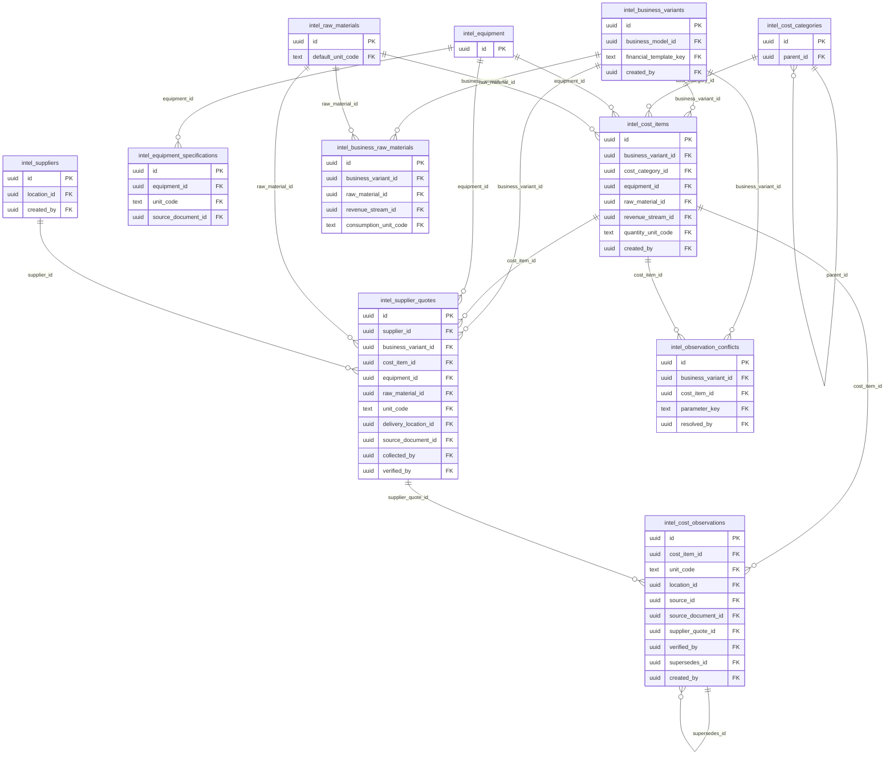
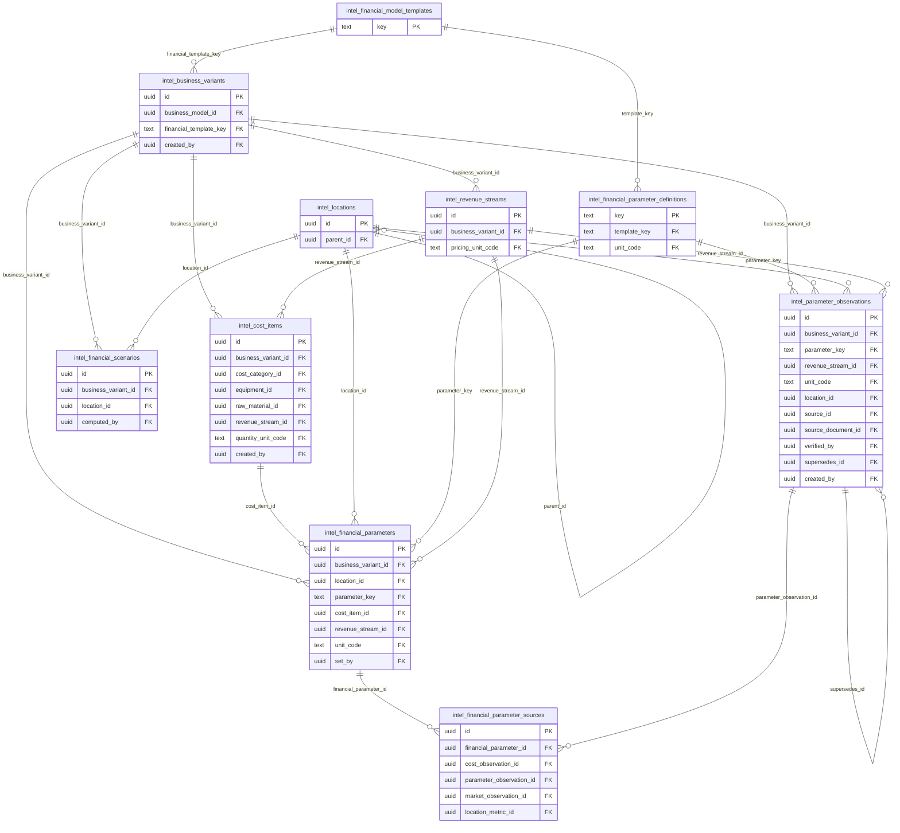
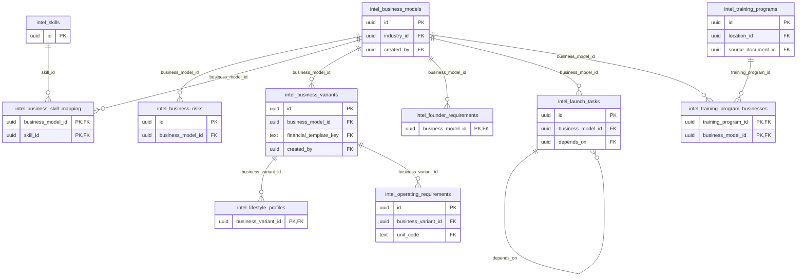
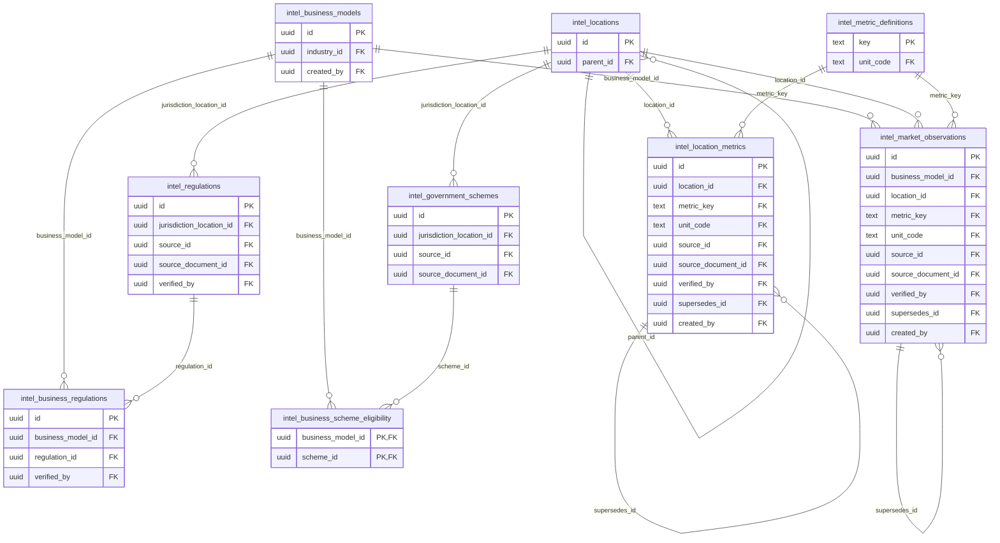
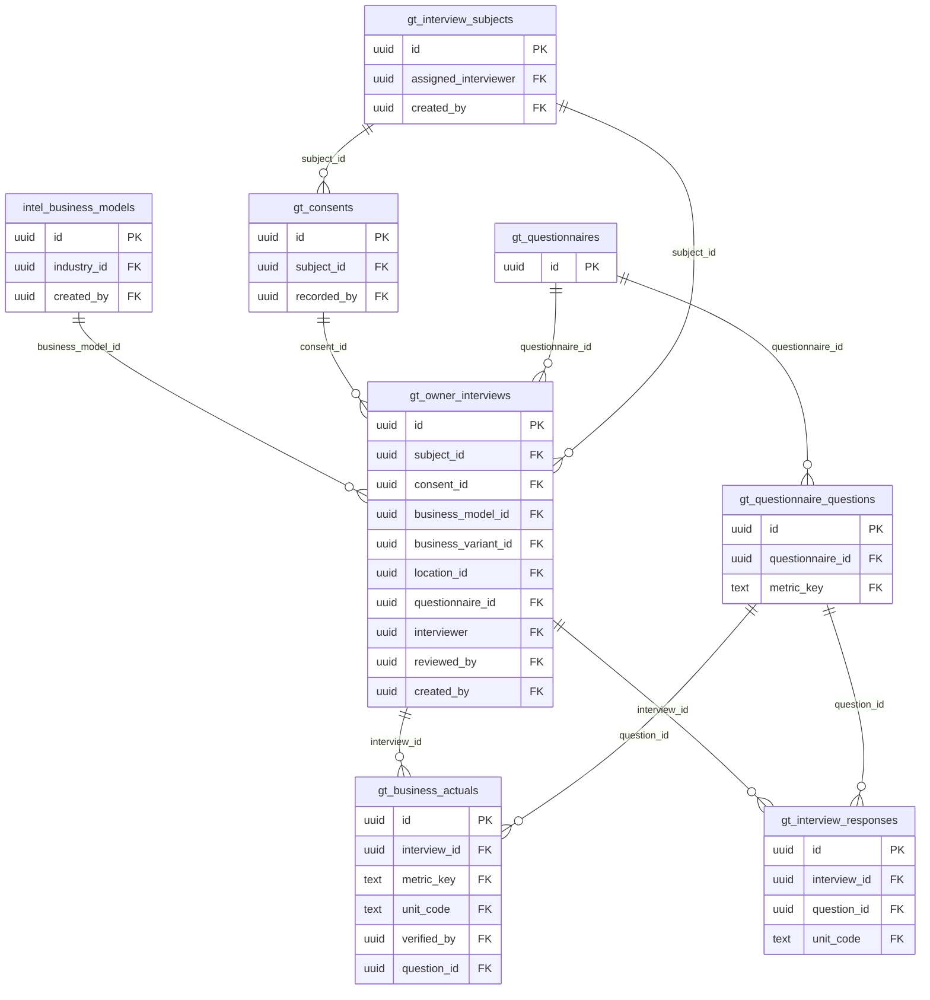
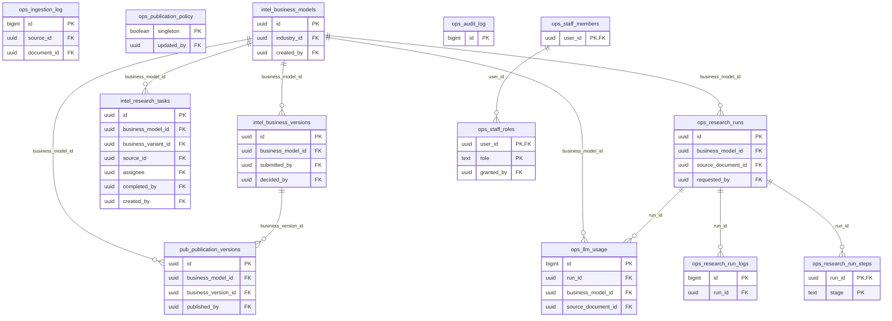
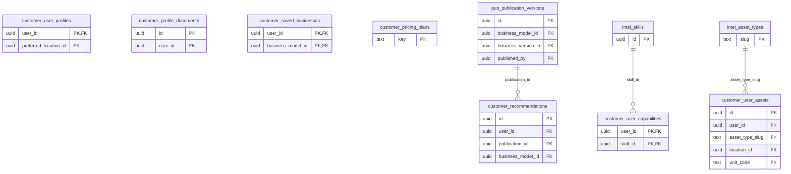

# PlanB entity-relationship diagrams

> Generated from the database catalogue by `scripts/gen_db_docs.py`. One diagram per domain; a table can appear in
> several diagrams where it joins domains. Columns shown are keys only — see `DATA_DICTIONARY.md` for every column.

Polymorphic links that foreign keys cannot express: `intel.evidence_links (target_table, target_id)` points at any evidenced record;
`intel.research_reviews (subject_type, subject_id)` at any reviewed record; `intel.research_tasks (target_table, target_id)` at the gap's subject.

## Taxonomy and business structure

## Evidence and provenance

## Costs, equipment and suppliers

## Financial model

## Requirements, founder, lifestyle, risk, execution

## Geography, market and regulation

## Ground Truth

## Research operations, review and publication

## Customer

